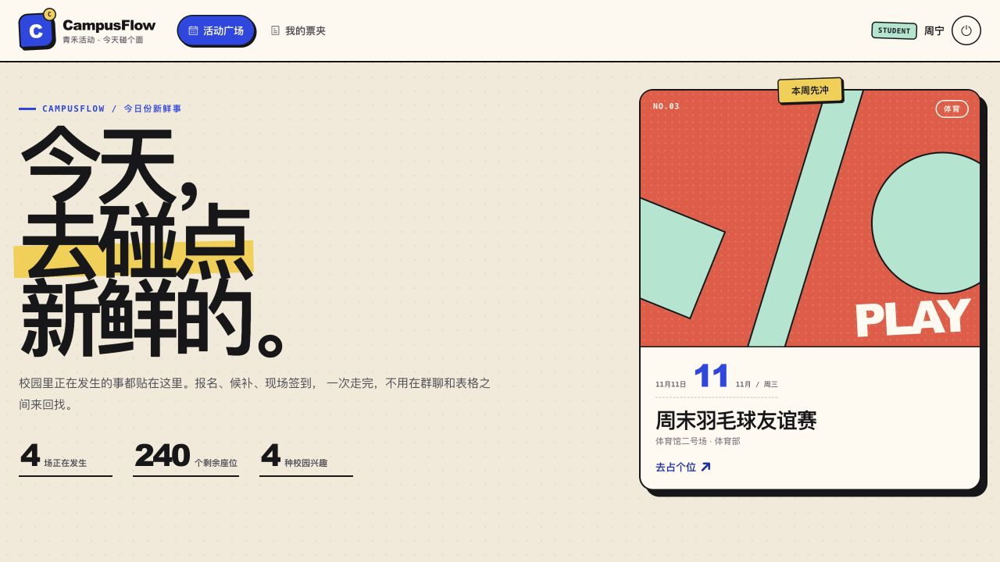
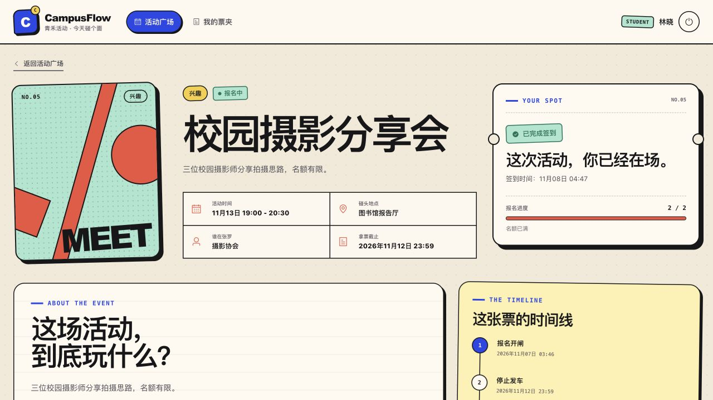
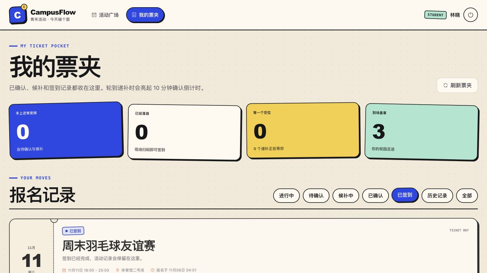
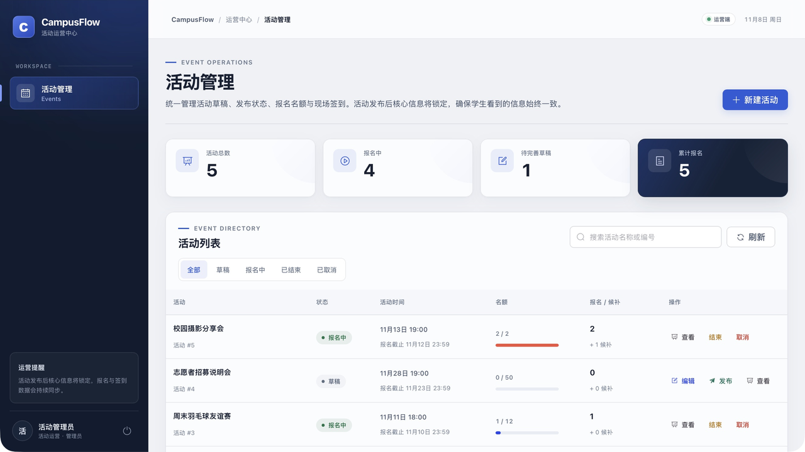
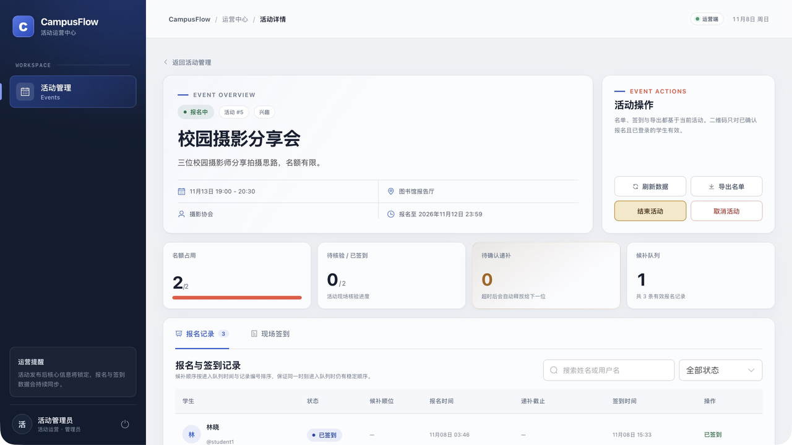
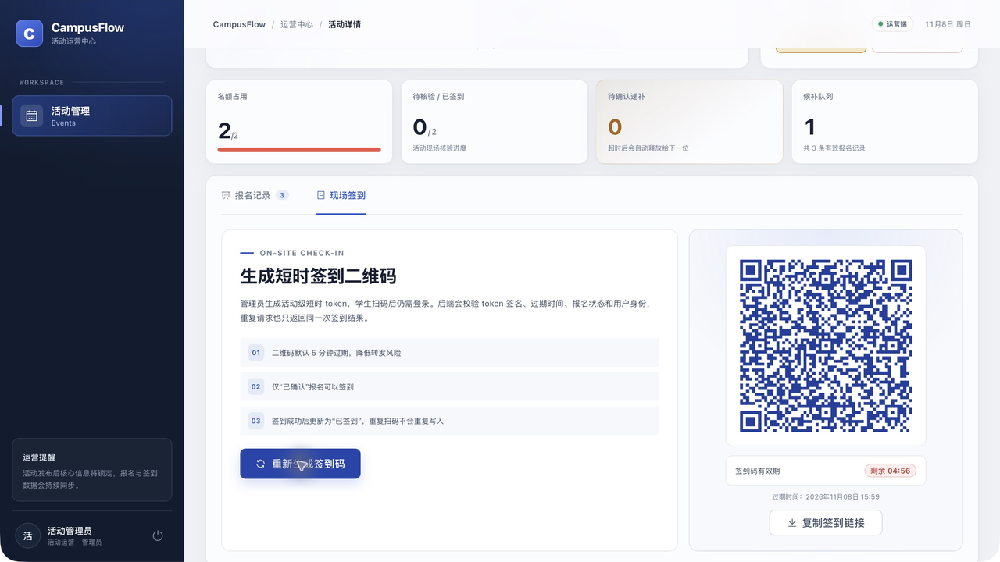

# CampusFlow 青禾活动

一个面向校园活动的报名、候补递补与现场签到系统，使用 Java 21、Spring Boot、MyBatis、MySQL 和 Vue 3 实现。

项目采用双端视觉语言：学生端是轻快的校园公告栏与拼贴海报风格，管理端是偏企业级的活动运营控制台。两端共用同一套业务接口与权限体系。

[](#验收与测试)
[](#验收与测试)
[](#验收与测试)

> 当前定位是可运行、可讲解、可继续扩展的单体 MVP，不宣称生产级高并发或真实学校运营数据。

## 界面预览

### 学生端

| 活动广场 | 活动详情与签到状态 |
| --- | --- |
|  |  |

| 我的票夹 |
| --- |
|  |

### 管理端

| 活动运营概览 | 报名与签到详情 |
| --- | --- |
|  |  |

| 短时签到二维码 |
| --- |
|  |

## 核心能力

### 学生端

- 浏览已发布活动，按分类、关键词和余位筛选。
- 在报名窗口内报名；名额已满时自动进入候补队列。
- 查看报名状态、候补顺位和递补确认倒计时。
- 取消报名或候补，座位按规则自动释放给下一位。
- 使用管理员展示的短时二维码完成现场签到。

### 管理端

- 创建活动草稿，编辑并发布活动。
- 查看活动汇总、报名名单、候补队列和签到进度。
- 手动签到，生成活动级二维码签到链接。
- 导出报名名单为 Excel。
- 结束或取消活动；取消活动会同步取消有效报名。

## 关键实现

### 1. 名额不超卖

报名事务先通过 `SELECT ... FOR UPDATE` 锁定活动行，再检查报名窗口、现有报名记录和剩余名额。占位成功时在同一事务内更新 `events.occupied_count`，并通过 `(event_id, user_id)` 唯一索引防止重复报名记录。

### 2. 候补 FIFO 与自动递补

名额释放后，系统按 `waitlist_time ASC, id ASC` 取候补队首，将其从 `WAITLISTED` 转为 `PROMOTED`，并保留一个 10 分钟确认窗口。

- 学生确认后转为 `CONFIRMED`。
- 超时未确认后转为 `EXPIRED`，名额继续递给下一位。
- 定时任务每 30 秒扫描过期递补；确认接口和扫描任务都会在锁内重新校验截止时间。

### 3. 二维码签到

管理员生成活动级 JWT 签到 token，默认 5 分钟过期，使用 HMAC-SHA256 签名。学生扫码后仍须登录，后端同时校验：

1. token 签名、类型和过期时间；
2. 活动是否存在且处于 `PUBLISHED`；
3. 当前用户是否有该活动的报名记录；
4. 报名是否已确认或已签到。

签到请求具有幂等性：首次签到写入时间，重复请求返回同一签到时间，不产生新记录。首次签到响应会重新读取数据库中的持久化时间，避免数据库 `DATETIME(3)` 精度导致返回值不一致。

### 4. 活动生命周期

活动状态流转为 `DRAFT → PUBLISHED → FINISHED / CANCELED`。管理端取消活动时，会将 `CONFIRMED / WAITLISTED / PROMOTED / CHECKED_IN` 报名统一转为 `CANCELED` 并把占位数量归零；结束活动只改变活动状态，保留报名和签到历史。

## 技术栈

| 层次 | 技术 |
| --- | --- |
| 后端 | Java 21、Spring Boot 3.5.16、Spring Security 6、Spring Validation |
| 数据访问 | MyBatis 3、MySQL 8.4、Flyway |
| 认证鉴权 | JWT（JJWT 0.12.6）、BCrypt、学生/管理员角色控制 |
| 文档与导出 | springdoc-openapi / Swagger UI、EasyExcel 4 |
| 前端 | Vue 3.5、Vite 8、Vue Router、Pinia、Element Plus、Axios |
| 测试 | JUnit 5、Spring Boot Test、真实 MySQL 集成测试 |

## 系统结构

```text
Browser
  ├─ Vue 3 SPA
  │    ├─ 学生端：活动广场 / 活动详情 / 我的票夹 / 扫码签到
  │    └─ 管理端：活动运营 / 报名名单 / 签到二维码 / Excel 导出
  │
  └─ Vite dev proxy: /api
       ↓
Spring Boot REST API
  ├─ Spring Security + JWT
  ├─ Controller / DTO
  ├─ RegistrationService / WaitlistPromotionService / CheckInService
  ├─ MyBatis Mapper
  └─ MySQL 8.4
       ↑
WaitlistExpiryJob 每 30 秒扫描过期递补
```

关键状态：

```text
CONFIRMED ──签到──> CHECKED_IN
CONFIRMED ──取消──> CANCELED

WAITLISTED ──名额释放──> PROMOTED
PROMOTED ──确认──> CONFIRMED
PROMOTED ──超时──> EXPIRED
PROMOTED ──放弃──> CANCELED
```

## 本地运行

### 环境要求

- JDK 21 或更高版本
- Node.js 20.19+（或 22.12+）与 npm
- MySQL 8
- 运行冒烟脚本时另需 `curl`、`jq`

### 1. 启动 MySQL

项目提供 macOS ARM64 的本地 MySQL 启动脚本，但数据库二进制和数据目录位于 `.runtime/`，不会提交到仓库。

如使用自带脚本，请将 MySQL 8.4 解压到：

```text
.runtime/mysql-8.4.13-macos15-arm64/
```

然后执行：

```bash
chmod +x scripts/*.sh
./scripts/mysql-start.sh
```

也可以使用本机已有的 MySQL，并通过环境变量覆盖连接配置：

```bash
export DB_URL='jdbc:mysql://127.0.0.1:3306/campus_event?useUnicode=true&characterEncoding=utf8&serverTimezone=Asia/Shanghai&allowPublicKeyRetrieval=true&useSSL=false'
export DB_USERNAME='campus'
export DB_PASSWORD='campus_dev_password'
```

测试库默认为 `campus_event_test`，后端集成测试会读写该库。

### 2. 启动后端

```bash
cd backend
./mvnw spring-boot:run
```

- API：`http://127.0.0.1:8080/api`
- 健康检查：`http://127.0.0.1:8080/actuator/health`
- Swagger UI：`http://127.0.0.1:8080/swagger-ui.html`

开发库为空时，应用会自动写入演示账号、活动与报名记录。

### 3. 启动前端

```bash
cd frontend
npm install
npm run dev
```

前端地址：`http://localhost:5173`

Vite 会把 `/api` 代理到 `http://127.0.0.1:8080`。

### 4. 演示账号

| 角色 | 用户名 | 密码 |
| --- | --- | --- |
| 管理员 | `admin` | `admin123` |
| 学生 | `student1` | `student123` |
| 学生 | `student2` | `student123` |
| 学生 | `student3` | `student123` |

登录页支持一键填充学生或管理员演示账号。

## 验收与测试

### 后端集成测试

```bash
cd backend
./mvnw test
```

当前结果为 **5 个测试类、8 个测试用例全部通过**，覆盖：

- 20 个学生并发争抢 5 个名额，最终 5 条确认报名、15 条候补，`occupied_count` 不超过容量；
- 重复报名幂等；
- 候补递补、确认、超时和继续递补；
- 二维码签到幂等、过期 token 拒绝；
- 活动草稿、发布、结束和取消生命周期。

### 端到端接口冒烟

确保 MySQL、后端和前端已启动，再运行：

```bash
./scripts/smoke-test.sh
```

脚本执行 12 项检查，覆盖登录、JWT 身份、学生活动与票夹、管理端列表/详情/名单、学生越权拦截、Excel 导出、签到 token、首次签到和重复签到一致性。

> 冒烟脚本会对演示活动 `#5` 中的 `student1` 执行一次签到，因此适合本地演示库使用。

### 前端构建

```bash
cd frontend
npm run build
```

构建产物输出到 `frontend/dist/`。当前构建通过，仅有 Vite 对较大第三方依赖 chunk 的体积提示。

## 二维码局域网说明

二维码内容基于当前页面的 `window.location.origin`。如果管理员通过 `localhost` 打开前端，手机通常无法访问二维码中的地址。

在 macOS 上查询局域网 IP：

```bash
ipconfig getifaddr en0
```

让电脑和手机访问同一个地址，例如：

```text
http://192.168.1.247:5173
```

再从该地址登录管理端并生成二维码。签到 token 默认 5 分钟后过期。

## 项目结构

```text
backend/                 Spring Boot API、MyBatis Mapper、Flyway 迁移与集成测试
frontend/                Vue 3 学生端与管理端
scripts/                 本地 MySQL 管理脚本与接口冒烟脚本
docs/adr/                架构决策记录
docs/design/             数据库与 API 设计
docs/images/             README 界面截图
docs/interview-notes.md  面试问答提纲
docs/resume-bullets.md   可验证的简历描述
GLOSSARY.md              领域术语表
```

## 设计文档

- [领域术语表](GLOSSARY.md)
- [ADR-0001：MySQL 行锁与唯一索引](docs/adr/0001-use-mysql-row-lock-for-seat-allocation.md)
- [ADR-0002：候补自动递补与确认窗口](docs/adr/0002-auto-promote-waitlist-with-confirmation-window.md)
- [ADR-0003：Spring Security 与 JWT](docs/adr/0003-spring-security-jwt.md)
- [ADR-0004：二维码签到 token](docs/adr/0004-qr-check-in-token.md)
- [数据库设计](docs/design/database.md)
- [API 设计](docs/design/api.md)
- [面试问答笔记](docs/interview-notes.md)
- [简历写法](docs/resume-bullets.md)

## 已知边界

- 同一活动的报名通过 MySQL 行锁串行化，热点活动吞吐受数据库限制；当前未引入 Redis、消息队列或分布式锁。
- 报名名单和 Excel 导出暂未实现大型活动分页。
- 结束活动后不会自动生成缺席记录，也没有站内信、短信或邮件提醒。
- JWT 暂无服务端撤销列表、刷新 token 和密钥轮换。
- 二维码只能降低随意伪造与转发的风险，不能证明学生物理上一定在现场。
- 开发密钥和演示账号仅用于本地运行，不应直接用于生产环境。

## 说明

本项目是个人学习与实习求职项目，不包含真实学校的生产数据。仓库中的截图、活动和用户均为本地演示数据。
